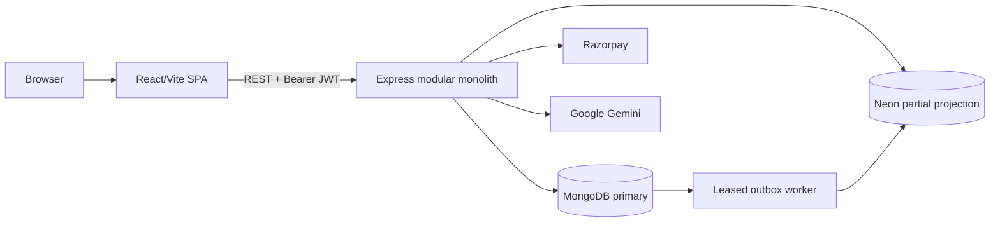

# Ghar Nishchit

## 1. Project Overview
Ghar Nishchit is a full-stack rental-management application for tenants, landlords, and administrators. It combines property discovery, enquiries, visits, contracts, maintenance, notifications, support, and Razorpay payments in a React frontend and Express modular monolith.

## 2. Problem Being Solved
Rental workflows are fragmented across listing sites, messaging, documents, maintenance calls, and payment records. This project puts those workflows behind role-specific dashboards.

## 3. Functional Requirements
- Tenants register, browse/favourite properties, contact landlords, schedule visits, review contracts, request maintenance, and pay.
- Landlords manage properties, enquiries, contracts, tenants, maintenance, and subscriptions.
- Administrators review users, properties, contracts, maintenance, payments, support, and broadcasts.

## 4. Non-Functional Requirements
Current priorities are access control, validation, responsive UI, payment integrity, and recoverable data synchronization. Formal SLOs, capacity targets, and recovery objectives are **Not currently implemented**.

## 5. Tech Stack
- React 19, Vite 8, React Router, TanStack Query, Tailwind, Recharts, Framer Motion.
- Node.js, Express 5, Mongoose, Zod, JWT, bcryptjs.
- MongoDB primary; Neon/PostgreSQL partial secondary projection.
- Razorpay and server-side Google Gemini integration.
- Playwright smoke tests and a Node/Supertest backend HTTP/unit suite.

## 6. High-Level System Architecture
The current system is a frontend/backend modular monolith. MongoDB is authoritative. Contract changes and their outbox records commit in one MongoDB transaction, then a leased worker projects them to Neon. Other selected records still use direct best-effort Neon writes.

## 7. Architecture Diagram


## 8. Request/Data Flow
Login validates a MongoDB password hash and returns JWTs. Protected requests verify the token, reload the current user, enforce account status, and enforce role. Controllers read/write MongoDB; selected writes are mirrored to Neon. Razorpay signatures use constant-time comparison, callbacks bind the internal record to the gateway order, and a durable webhook ledger suppresses replayed events.

## 9. Database Design
MongoDB collections cover users, properties, favourites, enquiries, visits, contracts, maintenance, payments, landlord payments, notifications, support, and outbox jobs. Embedded replies/history suit document retrieval; references model ownership. Neon contains incomplete projections and is not the authentication source.

## 10. API Architecture
REST groups under `/api` include auth, users, properties, favourites, tenants, maintenance, inquiries, notifications, payments, landlord-payments, visits, contracts, support, admin, and AI. REST matches the resource-oriented workflows. Versioning and OpenAPI are **Not currently implemented**.

## 11. Authentication & Authorization Flow
Public signup permits tenant/landlord roles. Admins are provisioned by script. Access tokens last one hour and refresh tokens 72 hours. Protected requests reload the MongoDB user and reject suspended/banned accounts. Backend RBAC is authoritative. Tokens remain in `localStorage`, an acknowledged XSS trade-off.

## 12. Important Engineering Decisions
- Modular monolith: low operational cost while domains stay separated by routes/controllers/models.
- MongoDB primary: the implementation and nested maintenance/message structures were built around Mongoose; Neon is not falsely presented as authoritative.
- REST: simple fit for CRUD workflows and browser/tool clients.
- JWT plus user lookup: current status/role changes apply before token expiry.
- Transactional contract outbox: the authoritative contract mutation and projection event commit together; atomic leases prevent duplicate concurrent claims and retries terminate in an admin-retryable dead-letter state.
- Payment idempotency: unique gateway IDs, order-bound state transitions, and a webhook-event ledger prevent repeated callbacks from repeating side effects.
- TanStack Query: server-state caching without a larger global-state framework.

## 13. Alternatives Considered
PostgreSQL-only storage offers stronger relational integrity but needs a deliberate migration. Cookie sessions improve token protection but require session storage and CSRF controls. Microservices/brokers add unjustified operational cost at current scale. Direct browser Gemini was removed because it exposed the key.

## 14. Trade-offs
The monolith is easy to run but scales workloads together. MongoDB supports evolving documents but relationships rely on application logic. JWTs reduce session state but localStorage increases XSS impact. Dual persistence introduces consistency risk.

## 15. Security Considerations
Implemented: bcrypt, server-side RBAC/ownership checks, account-status enforcement, auth validation, Helmet security headers, a CORS allowlist, 2 MB body limits, rate limiting, Razorpay HMAC checks, replay-resistant payment transitions, and focused signature tests. Refresh rotation, HttpOnly cookies, distributed limiting, comprehensive schemas, a secrets manager, and broad authorization security tests are **Not currently implemented**. See [Security](docs/SECURITY.md).

## 16. Error Handling & Reliability
The API has global structured error handling, traceable JSON 404s, signature checks, leased outbox retries/dead-letter recovery, dependency-aware health endpoints, and bounded graceful shutdown. Error shapes still vary and direct Neon writes can diverge.

## 17. Performance Considerations
Lazy routes and vendor chunks reduce frontend work. Admin overview metrics use MongoDB aggregation, admin tabs load their collections on demand, landlord payment attribution uses batched lookups, and property browse/search supports opt-in pagination. Compound indexes cover the corresponding ownership/status/time access paths. Unpaginated compatibility paths and large embedded documents remain risks. See [Performance](docs/PERFORMANCE.md).

## 18. Current Bottlenecks
- Admin section lists are still unpaginated after they are loaded on demand.
- Several non-property list endpoints lack pagination.
- Legacy clients can still request the complete admin dashboard payload.
- HTTP and outbox work share one process by default, although a standalone worker entrypoint and container are available.
- Cross-database writes lack full reconciliation.

## 19. Scalability Strategy
Extend pagination to the remaining lists, validate indexes with query plans, run controlled benchmarks, and deploy the standalone worker mode. API replicas are then technically possible, but load balancing and shared rate limiting are still required before calling the topology horizontally scalable.

## 20. Production Readiness
This is suitable for development and case-study use, not asserted production readiness. CI, container manifests, health endpoints, protected Prometheus-format metrics, structured request logs, transactional contract outbox recovery, versioned Neon migrations, and graceful shutdown provide a baseline. A live deployment, backups, dashboards/alerts, automated migration execution, and recovery drills are **Not currently implemented**. See [Production Readiness](docs/PRODUCTION_READINESS.md).

## 21. Known Limitations
- Incomplete MongoDB/Neon synchronization.
- Backend coverage is focused and does not yet exercise live databases, Razorpay, or the complete authorization matrix; there is no OpenAPI contract.
- LocalStorage refresh tokens are not rotated/revoked.
- Firebase login was removed because backend identity exchange was incomplete.
- Tenant Razorpay amounts are derived from active leases; landlord subscription pricing is still supplied by the client and requires a server-owned plan catalogue.
- No measured benchmarks.

## 22. Future Architecture
Keep the modular monolith until measured load requires stateless API replicas, a separately deployed worker, shared limiter/cache, managed backups, object storage, centralized telemetry, and CDN-hosted static assets. These are proposals, not current capabilities.

## 23. How to Run Locally
```powershell
cd backend
Copy-Item .env.example .env -ErrorAction Stop # only when .env does not exist
# Configure MongoDB and secrets
# Contract writes require Atlas or a MongoDB replica set because they use transactions.
npm install
npm test
npm run migrate:neon # when NEONDB_URL is configured
npm run create-admin # optional
npm run dev
```
```powershell
cd frontend/UI
npm install
npm run dev
```
Frontend: `http://localhost:5173`; backend: `http://localhost:5000`. Never commit `.env` files.

Neon compute wake-up can exceed a short connection timeout. The backend defaults `NEON_CONNECT_TIMEOUT_MS` to 20 seconds; increase it only if network reachability succeeds but a cold database still times out. `sslmode=require` in a Neon URL is normalized to explicit `sslmode=verify-full` to retain certificate and hostname verification without the `pg` compatibility warning.

Operational probes: `GET /health/live` confirms the process is responsive; `GET /health/ready` requires MongoDB and reports Neon degradation separately because MongoDB is authoritative.

Container topology (API, standalone outbox worker, Nginx-hosted SPA):

```powershell
# Configure backend/.env first. Docker Desktop must be running.
docker compose up --build
```

Metrics are disabled by default. Set `METRICS_ENABLED=true` and a strong `METRICS_TOKEN`, then scrape `GET /metrics` with `Authorization: Bearer <token>`. Admins can inspect and retry terminal outbox jobs through `/api/admin/outbox` and `/api/admin/outbox/:id/retry`.

## Engineering Documents
- [System Design](docs/SYSTEM_DESIGN.md)
- [Engineering Decisions](docs/ENGINEERING_DECISIONS.md)
- [Performance](docs/PERFORMANCE.md)
- [Security](docs/SECURITY.md)
- [Testing and Product Assessment](docs/TESTING_REPORT.md)
- [Database Integration Testing](docs/INTEGRATION_TESTING.md)
- [Production Readiness](docs/PRODUCTION_READINESS.md)
